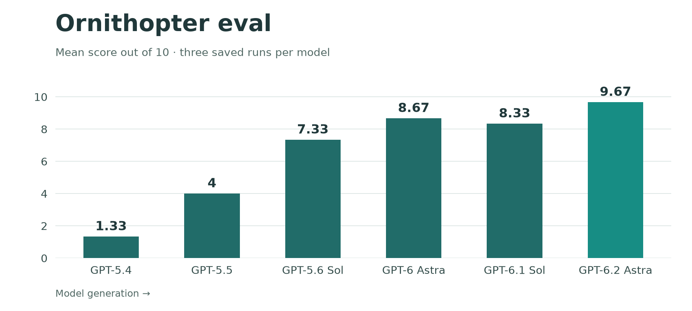

# Ornithopter Eval

My granddad drew a flying machine. I gave six models his notebook and eight minutes to build one I could fly.

Three attempts per model. Ten deterministic checks. I refined the graders after flying the saved attempts, then ran them all again.

- **[Fly the saved aircraft or run it yourself](docs/REPRODUCE.md)**
- [Notebook scans](audits/source-compatibility-20261104/sources) · [Task](candidate/mechanical-v7/TASK.md) · [Graders](docs/AIRFRAME_BINARY_V7.md) · [Scores](reports/model-progress/results.json)
